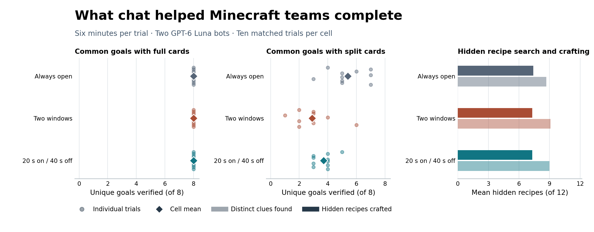

# Shared goals and hidden recipes in Minecraft

I ran 90 scored episodes with two GPT-6 Luna bots in Minecraft Hell’s Kitchen. Each of the nine task-by-schedule combinations had ten matched trials. The bots explored the room layouts, withdrew ingredients from real chests, and crafted at Minecraft tables. The Minecraft server independently verified every terminal inventory. [Protocol](PROTOCOL.md) · [Reproduction](REPRODUCE.md)

**More time to talk helped most when bots each held a piece of information needed to collect ingredients.** Always-open chat finished more split-card goals than either limited schedule. With full cards, every team finished all eight goals, and always-open chat finished sooner on average. With hidden recipes, the three schedules produced almost identical crafting scores.

## Results

Each cell reports mean verified goals, then pooled seconds spent per verified goal. This ratio divides total observed episode time by total verified recipes. An unfinished episode contributes the full 360 seconds and its actual verified goals.

| Task | Always open | Two 60-second windows | 20 seconds on, 40 off |
| --- | --- | --- | --- |
| Shared goals with full cards | 8.00/8 · 20.8 s/goal | 8.00/8 · 21.9 s/goal | 8.00/8 · 24.2 s/goal |
| Shared goals with split cards | 5.40/8 · 66.7 s/goal | 2.90/8 · 124.1 s/goal | 3.70/8 · 97.3 s/goal |
| Hidden recipes | 11.40/16 · 31.6 s/goal | 11.30/16 · 31.9 s/goal | 11.30/16 · 31.9 s/goal |

## What the traces show

**Full cards.** All 30 pairs completed eight goals. Always-open chat averaged 166.5 seconds to finish, compared with 175.1 seconds for two windows and 193.4 seconds for alternating chat. It finished faster than alternating in eight of ten matches. Duplicate crafting stayed high in every schedule. On average both bots crafted 5.8 of the same items with always-open chat, 6.1 with two windows, and 5.9 with alternating chat. In `2718-public-always`, Jill crafted bone meal after the previous open turn had already reported Andy holding it. This supports tracking whether bots act on progress reports in addition to measuring how often they talk.

**Split cards.** Always-open chat beat alternating in eight matches and tied in two. It beat two windows in nine matches and tied in one. With the same 120 scheduled chat seconds, alternating beat the two longer windows in seven matches, tied in two, and lost one. Always-open chat delivered 117 fragments that added information to the recipient’s card, compared with 78 for alternating and 51 for two windows. The extra opportunities to exchange missing information are one explanation for the result. The trial split the ingredient hints and used separate cupboard-code fragments to enforce the dependency. Vanilla crafting still happened at the Minecraft table. No pairs completed all eight split-card goals.

**Hidden recipes.** All pairs completed the four initially visible recipes. The schedules averaged 7.3 to 7.4 hidden crafts and 8.7 to 9.1 unique clues found. The limited schedules found slightly more distinct clues on average. That difference produced no corresponding gain in finished hidden recipes. Both bots often visited the same clue, even with always-open chat. In `2714-hidden-alternating`, the pair found all 12 hidden clues and crafted seven of those recipes. No pair reached all 16 goals under any schedule.

## Which ideas to keep

Shared goals with split information give the clearest follow-up to the earlier timing study. The matched full-card version shows what the same recipe orders look like when chat is mainly for coordination. Keep the two versions together, and preserve the matched comparison between the two 120-second schedules.

The hidden arm is promising for studying exploration. The two separate measures help distinguish discovery from execution, although this trial gave very similar crafting outcomes across schedules. The marker game measures discovery of a recipe in the world. A later study of invention can use custom recipes that the model cannot know from vanilla Minecraft.

Larger teams and hierarchical recipes are useful extensions once the two-agent design is stable. A recipe tree should count an intermediate craft when it happens, since crafting the final recipe can consume that intermediate. The original six-menu benchmark with individually assigned goals remains the baseline pilot. Its proposed ten-repeats-per-cell replication is a separate 180-trial design.

## Evidence and run health

The archive contains one verified trial per matched condition. It includes the 90 terminal server samples, actions, prompts, chat deliveries, and observed positions at clue visits. The verifier reconstructed 5,436 decision slots and every recorded transfer of peer information. All 90 terminal client snapshots agreed with their server samples. Of 1,519 scheduled eligible open rounds that were reached, 14 delivered no message update because their actual start fell outside the window. The runner disclosed no new peer information during those rounds.

The model returned usage for 5,374 decision slots, totaling 3,019,381 input-plus-output tokens. Sixty-two slots had no usable provider response and ten actions had game-level errors. Those outcomes remain in their assigned conditions. I added a fourth sandbox server during the sweep. Its auxiliary queue overlapped with the primary queue on six labels, and the active extra copies were stopped. The archive keeps only the designated record for each label. The three abbreviated preflight runs are excluded from the scores.

Ten trials per cell give matched evidence on this kitchen and model. The restricted action interface, fixed menus, and controlled code fragments define this result’s scope. [Raw trial archive](evidence.tar.gz) · [Machine-readable results](results.json)
