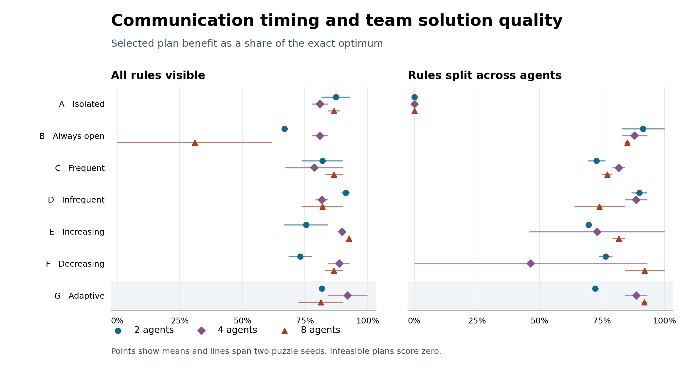

# When should agents communicate?

We completed **84 GPT-6 Luna trials** in a disposable Docker container. The fixed study covered six schedules, 2-, 4-, and 8-agent teams, two fixed puzzle seeds, and two information settings. The exploratory adaptive condition added 12 trials. Teams selected projects under two resource limits and eight rules. All rules were either visible to everyone or divided among the agents. Each team had 80 model-call slots and the same 76,800-token ceiling. [Design and outcome definitions](PROTOCOL.md)

## Main result

**The value of keeping chat open depended on which rules the agents already knew.** With all rules visible, isolated teams scored 85.0% of the optimum on average and always-open teams scored 59.6%. With private rule cards, all six isolated teams submitted infeasible final plans. Always-open teams averaged 88.2% of the optimum and submitted six feasible plans. Every schedule that allowed some sharing produced six feasible plans in the split-rule condition.

Each table cell contains the mean selected quality, then exact-optimum finds out of six in parentheses. Infeasible plans score zero. The feasibility column counts legal selected plans in the split-rule setting.

| Schedule | Open periods | Public rules | Split rules | Split-rule feasible |
| --- | --- | ---: | ---: | ---: |
| A. Isolated | None | 85.0% (0/6) | 0.0% (0/6) | 0/6 |
| B. Always open | 1–10 | 59.6% (0/6) | 88.2% (1/6) | 6/6 |
| C. Frequent | 2, 4, 7, 9 | 82.4% (0/6) | 77.2% (0/6) | 6/6 |
| D. Infrequent | 2–3, 8–9 | 85.0% (0/6) | 84.2% (0/6) | 6/6 |
| E. Increasing | 1, 6, 9, 10 | 86.0% (0/6) | 74.8% (1/6) | 6/6 |
| F. Decreasing | 1, 2, 5, 10 | 82.8% (0/6) | 71.7% (1/6) | 6/6 |
| G. Adaptive | Four per trial | 85.1% (1/6) | 84.3% (0/6) | 6/6 |

## What the schedule contrasts show

- **Frequent versus always open.** With public rules, C beat B in five of six matched pairs and averaged 22.8 percentage points higher. One 8-agent trial contributed most of the mean gap. Across the five other pairs the difference averaged 9.3 points. With split rules, B beat C in five of six pairs and averaged 11.0 points higher.
- **Frequent versus infrequent at equal exposure.** D averaged 2.6 points above C with public rules and 7.0 above with split rules. D won three of six public pairs and four of six split-rule pairs. There was one tie in each regime. This pilot did not show an advantage for more frequent openings at the same exposure.
- **Increasing versus decreasing.** E averaged about three points above F in both regimes. It won four of six public pairs and two of six split-rule pairs. The split-rule mean was sensitive to one large win.
- **Adaptive.** G’s mean was within 0.1 point of D in both regimes, with mixed matched outcomes. In split-rule trials, G maintained 10.6% final pairwise diversity compared with D’s 2.8%, at almost identical mean selected quality. This is an exploratory result from six matched pairs.
- **Team size.** There was no monotonic 2-to-4-to-8 advantage across the fixed schedules within either information setting. With equal team attempt counts, a larger group has fewer successive attempts per agent. Size comparisons describe that allocation.

[Full paired differences and size-specific results](results.json)

## Exploration, diffusion, and errors

| Schedule | Best individual, public / split | Mean individual, public / split | Final diversity, public / split | Shared-error phi, public / split | Prior peer duplication, public / split |
| --- | ---: | ---: | ---: | ---: | ---: |
| A | 85.0 / 38.4% | 76.0 / 9.4% | 19.0 / 18.6% | 0.33 / 0.29 | 11.7 / 15.8% |
| B | 59.6 / 88.2% | 52.3 / 75.5% | 2.1 / 3.4% | 0.57 / 0.48 | 85.1 / 81.3% |
| C | 82.4 / 77.2% | 68.5 / 72.8% | 13.0 / 2.9% | 0.45 / 0.36 | 70.5 / 83.5% |
| D | 85.0 / 84.2% | 69.6 / 69.7% | 8.9 / 2.8% | 0.42 / 0.32 | 66.8 / 77.3% |
| E | 86.0 / 74.8% | 82.5 / 69.8% | 4.3 / 6.8% | 0.27 / 0.30 | 59.8 / 66.8% |
| F | 82.8 / 71.7% | 76.3 / 49.1% | 3.6 / 12.2% | 0.42 / 0.48 | 79.9 / 68.3% |
| G | 85.1 / 84.3% | 81.6 / 73.0% | 8.9 / 10.6% | 0.41 / 0.35 | 54.6 / 70.2% |

The first open period gave each agent all eight rules. Fully isolated agents retained their starting coverage of four, two, or one rule per agent for teams of 2, 4, and 8 respectively. Reusing a peer’s proposal can spread a useful answer or a constraint violation. In the public trials, always-open chat had the lowest diversity, the largest share of attempts that duplicated an earlier peer, and the highest correlation of simultaneous errors. Frequent chat preserved more diversity in that setting. The study measures these mechanisms together and cannot attribute the quality difference to any one of them.

Average individual quality gained 7.7 points in public C trials and 10.9 in split-rule C trials when chat reopened, relative to the preceding closed period. The corresponding gains for D were 13.8 and 13.5 points. These are before-and-after changes at particular rounds. Improvement can also come from additional private attempts between the two measurements.

### Two trace examples

- **Copied infeasible plans in an always-open public trial.** On seed 5182 with eight agents, five agents proposed the same infeasible plan `BCDFP` in period 3 after it had been shared from period 2. By period 10 all eight attempts were variants of two infeasible plans. No viable nonempty plan was retained in that trial. The matched frequent-chat run found the feasible plan `BDFNP` and scored 65 out of 72. [Always-open trace](data/fixed/5182-public-8-B.json) · [Frequent trace](data/fixed/5182-public-8-C.json)
- **A locally plausible plan failed under hidden rules.** On seed 1937 with eight isolated agents and split rules, the selector chose `AFIJN`, worth 75 and within both resource limits. It violated two prerequisite rules the proposer had not seen. The full scorer assigned zero. The selector used the same public rule in every condition, so some of the split-rule penalty arises at selection. Across the six isolated split-rule runs, the best plan ever generated averaged 38.4% even though all selected plans scored zero. [Isolated trace](data/fixed/1937-distributed-8-A.json)

## Runtime and verification

The offline verifier reconstructed **6,720 attempt inputs** from their histories and matched the recorded prompts, relay states, schedules, and per-slot token ceilings. Across all trials the API reported **3,566,339 input-plus-output tokens**. Another 12,480 tokens were conservatively reserved on rejected generation slots. The API returned 52 slots without a usable plan out of 6,720, including 13 prompt rejections and four incomplete generations. Transport did not leave any generation usage unknown in the scored runs. Preflight attempts are excluded.

Mean measured usage ranged from 37,782 to 45,039 tokens across schedule-by-information groups. The ceiling was matched and most teams spent less than it. Open chat adds prompt context, so realized consumption varied. Episodes took 17.6 to 88.3 seconds with concurrent API scheduling. The experiment recorded wall time without enforcing an equal deadline. [Machine-readable results](results.json) · [Reproduction guide](REPRODUCE.md)

## Scope for a paper

The strongest pilot finding is the interaction with information access. When all rules were already public, repeated sharing coincided with more duplicate proposals and lower diversity. When constraints were private, some communication was essential for reliable final feasibility in these two puzzles. The split-rule task needs initial integration of complementary facts. Ongoing dependencies, such as physical handoffs in MineCollab, could behave differently. Exact success was rare, with four of 84 teams reaching the optimum and 23 reaching at least 90%.

The two puzzle seeds, single model, and automatic exchange of structured plans limit generalization. The six matched blocks per information setting reuse the same two puzzles at different sizes. Treat the differences as descriptive. A paper can frame this as a pilot adaptation of the timing manipulation and motivate a confirmatory test of the interaction across independent tasks. Experiments on test-time communication already compare sharing with independent search, so a broad novelty claim about communication alone would need further qualification. [2018 PNAS timing experiment](https://www.pnas.org/doi/10.1073/pnas.1802407115) · [Scaling Discovery through Test-Time Communication](https://arxiv.org/abs/2609.21032)
