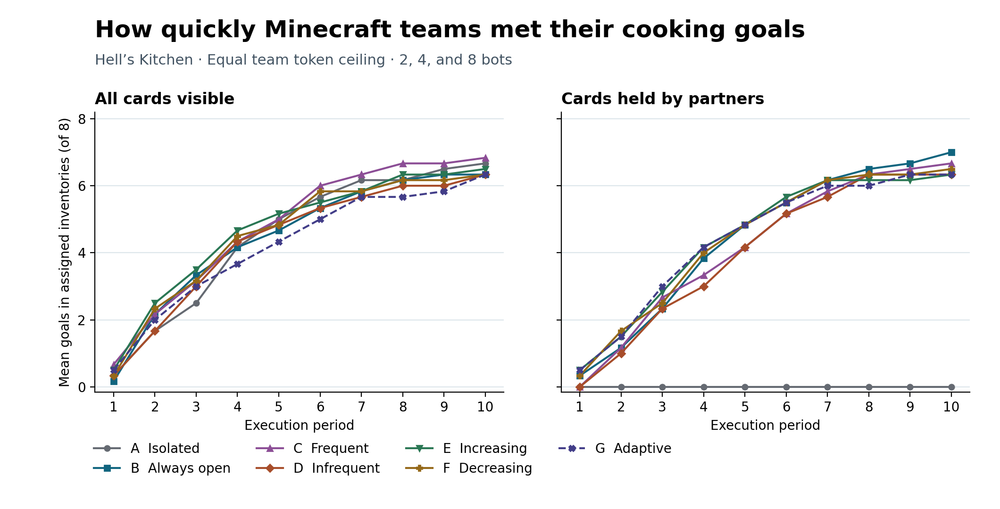

# Communication timing in Minecraft Hell’s Kitchen

The Minecraft server verified all 84 scored episodes. The fixed comparison has 72 episodes, with 12 additional adaptive trials. GPT-6 Luna controlled 2, 4, or 8 bots in the MineCollab Superflat arena. The bots collected ingredients from real chests and crafted bread, golden apples, pumpkin pie, cookies, and other items at Minecraft crafting tables. Each trial used the Harvest or Bakery recipe set and had eight assigned goals. [Protocol and recipe allocation](PROTOCOL.md)

## Results at the final inventory check

Each cell shows how many teams finished with all eight items, followed by the mean number of items held by their assigned bots. Every schedule has six trials per information setting.

| Schedule | All cards visible | Cards held by partners |
| --- | --- | --- |
| A · Fully isolated | 2/6 finished · 6.67 of 8 | 0/6 · 0.00 of 8 |
| B · Always open | 1/6 · 6.33 of 8 | 2/6 · 7.00 of 8 |
| C · Frequent | 2/6 · 6.83 of 8 | 2/6 · 6.67 of 8 |
| D · Infrequent | 1/6 · 6.33 of 8 | 1/6 · 6.33 of 8 |
| E · Increasing | 2/6 · 6.50 of 8 | 1/6 · 6.33 of 8 |
| F · Decreasing | 2/6 · 6.33 of 8 | 1/6 · 6.50 of 8 |
| G · Adaptive | 1/6 · 6.33 of 8 | 1/6 · 6.33 of 8 |

**Sharing mattered most when a partner had the card.** The six isolated split-card teams produced none of their assigned items. Some collected the right ingredients and then waited. All six communicating schedules averaged at least six goals in this setting. Always-open chat had the highest mean, seven of eight, and tied frequent chat for the highest exact completion count. Every schedule that opened the channel gave the bots all cards at its first opening. The design shares assignments and recipes together, so it does not distinguish which information produced the improvement.

**Once cards were visible from the start, the means were close.** They ranged from 6.33 to 6.83 items. At equal exposure, frequent opening produced more terminal items than infrequent opening in four of six public-card blocks and two of six split-card blocks. The other split-card blocks tied. The average gain was 0.50 items with public cards and 0.33 with split cards. Adaptive and infrequent chat had identical mean scores and completion counts in both settings. Each schedule has only two recipe sets per team size, so the ranking is preliminary. [Matched comparisons and period-level scores](results.json)

## Team size under the shared budget

| Team size | Fixed A–F, all eight items | Adaptive G, all eight items | Goals per bot |
| --- | ---: | ---: | ---: |
| 2 | 0/24 | 0/4 | 4 |
| 4 | 14/24 | 2/4 | 2 |
| 8 | 3/24 | 0/4 | 1 |

Four-bot kitchens completed the most recipes in these trials. Holding eight total goals and 80 team slots fixed changed both the number of goals per bot and its number of attempts. The team-size comparison describes this allocation. The 19 exact successes include three eight-bot runs and 16 four-bot runs. In 63 of 84 trials at least one bot held all of its own assigned items.

## What the game traces show

- In `harvest-public-8-E`, eight bots completed all goals. The server reported bread for Andy, pumpkin pie for Jill, and a golden apple for Taylor, alongside the other five targets.
- In `harvest-split-8-B`, Taylor knew the golden-apple recipe. Taylor withdrew the gold one ingot at a time, tried to craft with seven ingots in period 9, and took the eighth in period 10. The terminal inventory had the apple and eight ingots but no golden apple. The other seven goals were satisfied. The action interface allowed one withdrawal to take several of the same item.
- In `harvest-split-4-A`, the bots withdrew wheat, melon, pumpkin, eggs, sugar cane, and bones. No one learned their own intended dishes through the relay, and the server found zero assigned dishes at the end.

Across the cohort the controller recorded 834 craft attempts. The inventory gained the requested item after 618 of them. Forty-one failures repeated a prior failure by the same bot on the same recipe with an unchanged inventory. The run records include distinct recipes attempted, error correlation among simultaneous game actions, gains in reopening periods, and per-bot attainment. These diagnostics describe the controlled crafting interface. A successful repeated action can be useful, and assigned recipes strongly influence which recipes each bot attempts.

## Runtime and verification

Every scored trial had 80 action slots and a 76,800 input-plus-output token ceiling. The verifier reconstructed relay content and its appearance in the prompts across **6,720 slots**. It independently read the terminal inventories from the game logs and checked that counted goals followed a real craft. The model provider reported **2,333,326 tokens** across scored attempts. There were 25 rejected requests and 136 slots without an accepted action, including those rejections. Configuration and network failures were tracked separately from failed recipes.

Timed execution lasted 22.0 to 81.4 seconds per trial after the stations were ready. Team size changed the number of simultaneous model calls, and multiple servers shared the sandbox’s CPUs. The comparison used execution periods and a token ceiling. Wall-clock time was recorded descriptively.

A preflight tested the eight-bot path and was excluded. In one scored-condition attempt, Mineflayer showed a hay bale after its last tick while the server reported an empty inventory for that bot. The attempt was kept outside the scored cohort. A fresh run of the same condition completed with matching server and client inventories. The reproduction runner waits briefly before the terminal query so the final update can reach the server. The scored evidence contains one verified terminal record for every condition.

The kitchen used the same controlled `take`, `craft`, and `wait` interface for all schedules, with one station assigned to each bot. The evidence supports an effect of receiving missing goal information. The small differences among communicating schedules need more recipe sets before drawing a general conclusion, especially for open-world tasks with repeated physical handoffs.

[Evidence archive](evidence.tar.gz) · [Machine-readable results](results.json) · [Reproduction guide](REPRODUCE.md)
