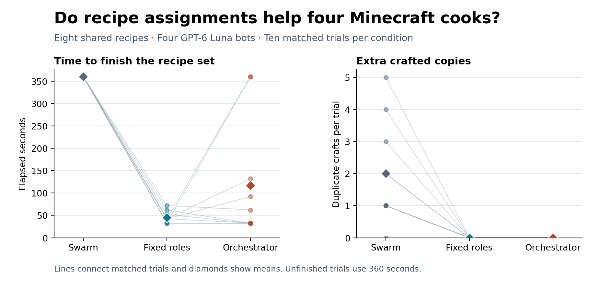

# Swarm coordination and recipe ownership in Minecraft

**Fixed recipe ownership was the most reliable setup in this kitchen.** All ten fixed-role teams completed the eight shared recipes. Eight of ten teams with an orchestrator completed them, and every swarm team reached the six-minute deadline with unfinished recipes.

The 30 scored trials used four GPT-6 Luna bots in Minecraft Hell’s Kitchen. Every bot knew the full recipes and could physically collect from a chest and craft at its own table. All conditions used the same chat channel, action cadence, and team token ceiling. Fixed-role and orchestrator trials started with the same assignments in each match. The orchestrator could change those assignments while continuing to cook. [Protocol](PROTOCOL.md)

| Setup | Finished all 8 | Mean recipes out of 8 | Mean elapsed time | Seconds per verified recipe | Mean extra crafts |
| --- | ---: | ---: | ---: | ---: | ---: |
| Swarm | 0/10 | 5.3 | 360.0 s | 67.9 | 2.0 |
| Fixed roles | 10/10 | 8.0 | 45.4 s | 5.7 | 0.0 |
| One orchestrator | 8/10 | 7.8 | 116.9 s | 15.0 | 0.0 |

Elapsed time uses the six-minute deadline for unfinished episodes. Seconds per verified recipe divides total elapsed time by total goals. An extra craft is a successfully made copy beyond the first for that recipe.

## What happened in the kitchen

**Swarm teams often stopped pursuing unfinished recipes.** They made 20 extra copies across ten runs. More importantly, bots selected `wait` on 1,047 of 1,440 decisions (72.7%) while the team still had missing recipes. There were 136 turns when all four waited with work unfinished. Packed mud was missing at the deadline in nine runs, and hay was missing in eight. In seed 3217, three bots initially collected the golden-apple kit. On turn 27, Sam said all recipes were held, while the team snapshot showed four items and the server subsequently verified only those four. Every bot had the full list of recipes and a stocked chest.

**Fixed roles maintained coverage.** All ten teams finished within 32.5 to 72.1 seconds. They collected each kit once and crafted each target once. There were eight wait decisions with work unfinished across 212 slots. The recipe ownership list gave each bot two concrete targets. Crafting a teammate’s recipe remained available through the action interface.

**Dynamic authority was used sparingly.** The leaders made three accepted changes across ten trials. All ten leaders crafted at least one recipe themselves. The orchestrator was quicker than fixed roles in five matched trials. Two deadline misses account for much of its higher mean elapsed time. In the eight matched pairs where both setups finished, the orchestrator averaged 56.1 seconds and fixed roles averaged 47.3 seconds.

In seed 3216, Jill reassigned golden apple to Andy on the first turn while she collected paper. She went on to craft paper, and the team finished. In seed 3219, Andy reassigned bone meal to Sam on turn 2. Bone meal stayed on Sam’s roster but no bot ever selected its kit or craft. The server verified seven recipes. Both unfinished orchestrator teams missed bone meal. No wait decisions were classified as explicitly waiting for instructions from their text. The large difference in waiting reflects broader inaction and mistaken judgments about work already covered.

The evidence associates **explicit recipe ownership with better coverage and less idle time** under these conditions. Dynamic authority had limited use in this roster-based setup. The study gives no independent estimate of how much the roster helps by supplying a visible checklist, or whether reassignments would pay off after a worker loses access to supplies. It used one menu and ten matches per condition.

## Verification and recorded evidence

The scorer verified all 30 terminal states against the Minecraft server. All 120 bots joined, and all client and server terminal inventories agreed. It reconstructed the roster and team snapshot supplied to each cook across 2,144 decisions. The provider reported 971,277 tokens across 2,143 responses. One HTTP 400 was recorded in the orchestrator arm. No scoring runs were excluded or repeated. The three abbreviated preflight trials are outside the cohort.

The scored evidence includes assignment changes, prompts, chat, real kit withdrawals and crafts, and terminal inventories. The three worked examples above are available in `3217-swarm/trace.json`, `3216-orchestrator/trace.json`, and `3219-orchestrator/trace.json` in the archive.

[Raw trial archive](evidence.tar.gz) · [Machine-readable results](results.json) · [Reproduction guide](REPRODUCE.md)
