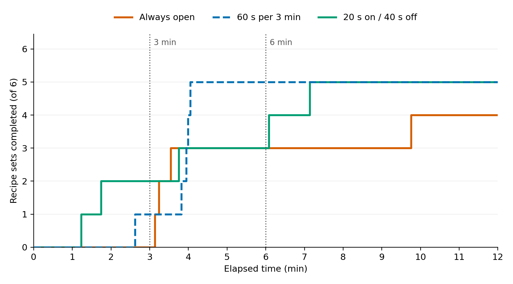

# How many pairs still finish after six minutes?

We ran 18 new trials with the same six recipe sets and eight goals per trial as the [six-minute study](LONG_RESULTS.md). Two GPT-6 Luna agents worked in a fresh Minecraft world each time. Each agent held the other agent’s goal card. Success required all eight items to be present simultaneously in the assigned inventories.

The three chat schedules matched the previous experiment through six minutes. We extended each schedule to twelve minutes. Chat was either always open, open for the first 60 seconds of each three-minute segment, or open for the first 20 seconds of every minute. The two limited-chat schedules offered equal scheduled chat time. The server verified finish times and sampled both inventories at three and six minutes for trials still active.

The primary outcome counts teams that were still working at the six-minute checkpoint and finished by twelve minutes. The paired schedule contrast uses six matched recipe sets. Trials that never finish receive the deadline in capped-time comparisons. [Fixed protocol](EXTENDED_PROTOCOL.md) · [Reproduction guide](EXTENDED_REPRODUCE.md)

## Three more pairs finished after six minutes

**Eleven of 18 pairs finished by 6:00 and 14 finished by 12:00.** Three of the seven still working at 6:00 finished at 6:05, 7:08, and 9:45. Four remained unfinished at 12:00. Two of those four gained goals in the second half and two ended with the same goal count. Their eventual finish times are unknown.

| Chat schedule | By 3 min | By 6 min | By 12 min | Late finishes among runs unfinished at 6 min | Mean time capped at 12 min |
| --- | ---: | ---: | ---: | ---: | ---: |
| Always open | 0/6 | 3/6 | 4/6 | 1/3 | 436.7 s |
| One 60 s window per 3 min | 1/6 | 5/6 | 5/6 | 0/1 | 304.1 s |
| 20 s chat / 40 s exploration | 2/6 | 3/6 | 5/6 | 2/3 | 319.4 s |
| Total | 3/18 | 11/18 | 14/18 | 3/7 | 353.4 s |

## The limited-chat schedules tied by twelve minutes

Longer windows led alternating chat in completions at six minutes. Two alternating pairs then caught up, bringing both schedules to five finishes. At twelve minutes, the prespecified difference in mean capped time for alternating minus longer windows was **+15.3 seconds**. Alternating had the lower capped time in two sets and the higher time in four. Paired differences ranged from −615.6 to +477.0 seconds. The descriptive 95% block bootstrap interval was −275.2 to +257.7 seconds, and the exact two-sided sign-flip reference was *p* = 0.906. The six-block comparison leaves substantial uncertainty about which schedule is faster. [Numerical results](extended-results.json)

| Recipe set | Always open | One 60 s window per 3 min | 20 s chat / 40 s exploration |
| --- | ---: | ---: | ---: |
| Woodwork | 187.9 s | 236.5 s | 73.7 s |
| Metalwork | 194.2 s | 157.0 s | 225.2 s |
| Harvest | 212.7 s | 243.0 s | Unfinished (6/8) |
| Dyes | Unfinished (4/8) | 229.0 s | 428.2 s |
| Masonry | 585.4 s | 239.1 s | 364.7 s |
| Bakery | Unfinished (7/8) | Unfinished (6/8) | 104.4 s |

Numbers in parentheses count objectives in the correct inventories at twelve minutes. All successful episodes had a verified finish timestamp.

## What the extra time looked like

- **Masonry, always open** held four goals at both 3:00 and 6:00. At 8:34 the bots reported finding the stone supplies in a chest. They crafted the remaining items and transferred them to Andy. The server verified all eight at 9:45. [Six-minute inventory](data/extended/b05-masonry-always/checkpoint-360.json) · [Supply discovery](data/extended/b05-masonry-always/events.jsonl#L1441) · [Final handoff](data/extended/b05-masonry-always/events.jsonl#L1640)
- **Dyes, alternating** reached five goals by 6:00. After chat reopened, Jill repeated Andy’s four dye targets at 6:11. The bots checked supply chests and issued more crafting commands. The server verified the eighth goal at 7:08. [Six-minute inventory](data/extended/b04-dyes-alternating/checkpoint-360.json) · [Goal reminder](data/extended/b04-dyes-alternating/events.jsonl#L1102)
- **Masonry, alternating** had seven goals at 6:00. The next recorded commands included crafting and giving an item to the other player. The server verified the finish at 6:05. [Six-minute inventory](data/extended/b05-masonry-alternating/checkpoint-360.json) · [Commands](data/extended/b05-masonry-alternating/events.jsonl#L1102)
- **Harvest, alternating** went from five goals at 6:00 to six at 12:00 and stayed unfinished. More time let the pair make progress in some cases that remained failures under the all-items score. [Six-minute inventory](data/extended/b03-harvest-alternating/checkpoint-360.json) · [Server log](data/extended/b03-harvest-alternating/minecraft.log)
- **Bakery, always open** held seven goals at both 6:00 and 12:00. Both bots said they had finished and used `!stay(-1)` to stay indefinitely. Andy still lacked packed mud. This run shows how a pair can stop working before the deadline when the agents misjudge their own progress. [Andy’s message](data/extended/b06-bakery-always/events.jsonl#L919) · [Jill’s message](data/extended/b06-bakery-always/events.jsonl#L939) · [Server log](data/extended/b06-bakery-always/minecraft.log)

## Run health and what the paper can claim

All 18 trials started the server, recorded both agents joining, returned GPT-6 Luna responses, and saved both terminal inventories. The 15 three-minute samples and seven six-minute samples contained both inventories and arrived within 643 ms of their scheduled times. No relayed chat crossed a closed gate. We recorded 2,452 model responses, one surfaced model error in the successful alternating bakery run, three agent restarts, 39 Minecraft protocol read errors, and six server tick-delay warnings. All assigned trials remain in the analysis. The batch spanned 49 minutes 23 seconds from the first trial start to the last verified endpoint. [Run evidence](data/extended)

The later checkpoint shows how often a six-minute score missed eventual success in this batch. It also shows why extra time can help with searching, crafting, or transferring items while leaving some coordination failures unresolved. The original six-minute batch recorded 13 finishes at six minutes, versus 11 at the same cutoff in the new samples. At that cutoff, the alternating schedule’s capped mean went from 41.9 seconds lower in the earlier batch to 3.1 seconds higher in the new batch. The two batches used independent model responses and different announced deadlines. The results support reporting checkpoint sensitivity and variation across recipes. A causal estimate for the announced deadline would require randomly assigning it within the same experiment. [Six-minute study](LONG_RESULTS.md) · [Fixed protocol](EXTENDED_PROTOCOL.md)
