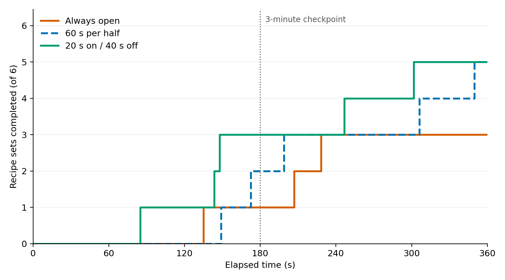

# Completion after the original MineCollab deadline

The earlier phase study used three recipe sets with six objectives per episode and a 180-second limit. This follow-up used six matched sets, eight objectives per episode, and a 360-second limit. It recorded an intermediate server inventory at 180 seconds and continued unfinished episodes. Each recipe set was tested under always-open chat, one 60-second chat window per three-minute half, and cycles of 20 seconds of chat followed by 40 seconds of exploration. All physical actions stayed available. The two limited-chat policies had the same scheduled chat time in each half.

Completion requires concurrent possession of the assigned eight items in the correct inventories, verified by the Minecraft server. The average capped time uses the deadline for unfinished episodes. The [fixed protocol](LONG_PROTOCOL.md), [recipe sets](long_scenarios.json) and [assignment manifest](long_design.json) describe the matched comparison. The [reproduction walkthrough](LONG_REPRODUCE.md) covers offline analysis and new episodes.

## What happened after three minutes?

**Six of 18 pairs finished by three minutes and 13 finished by six minutes.** Seven of the 12 pairs still working at the checkpoint finished in the second half. The late finishes ranged from 3:19 to 5:50, with a median of 4:07. Five pairs remained unfinished at six minutes. Their eventual completion times are unknown.

| Chat schedule | Finished by 3 min | Finished by 6 min | Late finishes among runs unfinished at 3 min | Mean capped time at 6 min |
| --- | ---: | ---: | ---: | ---: |
| Always open | 1/6 | 3/6 | 2/5 | 275.0 s |
| One 60 s window per half | 2/6 | 5/6 | 3/4 | 256.0 s |
| 20 s chat / 40 s exploration | 3/6 | 5/6 | 2/3 | 214.1 s |
| Total | 6/18 | 13/18 | 7/12 | |

The early lead for alternating chat in completion counts narrowed to a tie with the longer windows. Always-open chat finished fewer sets at both checkpoints. The observed finish times show how much work a three-minute score would have missed on these tasks under the six-minute instructions.

## Did shorter, repeated windows help?

At six minutes the prespecified mean capped difference, alternating minus the longer windows, was **−41.9 seconds**. Alternating was faster in three recipe sets and slower in three. Paired differences ranged from −275.0 to +152.7 seconds. The descriptive 95% block bootstrap interval spanned −168.0 to +76.0 seconds, and the exact two-sided sign-flip reference gave *p* = 0.625. The six blocks leave substantial uncertainty about which schedule is faster. [Matched contrasts](long-results.json)

| Recipe set | Always open | One 60 s window per half | 20 s chat / 40 s exploration |
| --- | ---: | ---: | ---: |
| Woodwork | Unfinished (4/8) | 306.1 s | Unfinished (4/8) |
| Metalwork | 228.1 s | 172.6 s | 246.6 s |
| Harvest | 207.0 s | 349.8 s | 143.6 s |
| Dyes | Unfinished (3/8) | Unfinished (3/8) | 85.0 s |
| Masonry | Unfinished (7/8) | 198.7 s | 147.8 s |
| Bakery | 135.1 s | 148.9 s | 301.6 s |

Numbers in parentheses are objectives in the correct inventories at six minutes. Dyes produced the largest favorable matched difference for alternation. Bakery and metalwork both finished sooner with longer windows.

## How pairs caught up

In woodwork under two 60-second windows, Jill held all four of her targets at three minutes. Andy held none of his. At 206 seconds the pair discussed where to find oak planks. The server verified all eight targets at 306 seconds. The other two woodwork runs still had just Jill’s four targets at six minutes. [Three-minute inventory](data/long/b01-woodwork-two_blocks/checkpoint.json), [event log](data/long/b01-woodwork-two_blocks/events.jsonl)

In alternating bakery, the pair went from five targets at three minutes to all eight at 302 seconds, with no relayed chat in the second half. Late finishes can include further communication or more time to execute a plan made earlier. Individual traces cannot establish which action caused a finish. [Three-minute inventory](data/long/b06-bakery-alternating/checkpoint.json), [event log](data/long/b06-bakery-alternating/events.jsonl)

## Run health and interpretation

All 18 episodes ran in the isolated Docker sandbox. Both agents joined and the server recorded both terminal inventories for every episode. The logs contain 2,069 GPT-6 Luna API responses and zero surfaced model errors. The three agent restarts occurred in harvest, with one under alternating chat and two under the longer windows. The study recorded 39 Minecraft protocol read errors. All 12 checkpoint samples included both inventories and were received within 648 ms of their scheduled time. The chat audit found no relayed messages outside an open window. The analysis includes every assigned episode. [Evidence](data/long), [machine-readable results](long-results.json)

The extension measures how many pairs finished after three minutes and tests the schedules across more recipe sets. Each recipe set had one episode per schedule, and every episode used the same model. The longer deadline and higher objective count were introduced together, so their separate effects remain untested. The observed late finishes apply to these six-minute episodes. The earlier three-minute episodes cannot be retrospectively extended.
