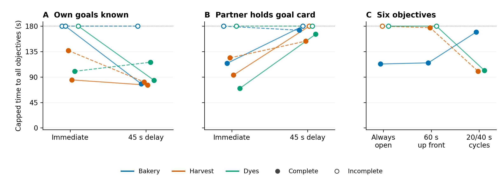

# When should two agents talk in a shared crafting task?

## Abstract

We tested when two language-model agents should communicate during a time-limited crafting task. In 24 matched four-objective episodes, a 45-second opening without chat reduced mean capped completion time by 41.1 seconds when agents knew their own objectives, and increased it by 45.1 seconds when each agent's partner held its objective card. The estimated interaction was +86.2 seconds across six world blocks. In nine exploratory six-objective episodes, repeating 20 seconds of chat and 40 seconds of independent play completed three of three scenarios, compared with two of three for a single opening window with the same scheduled chat time and one of three for always-open chat. The alternating schedule was slower in one scenario and faster in two. These results motivate information-sensitive timing policies for the tested benchmark.

The [six-minute extension](LONG_RESULTS.md) follows these two experiments with 18 additional episodes, six recipe sets, and eight objectives per episode.

A [twelve-minute follow-up](EXTENDED_RESULTS.md) repeats the same recipe sets and eight objectives. Three of the seven runs still unfinished at six minutes completed by twelve minutes.

## Introduction

Two agents can share plans as soon as play begins, or collect resources independently and exchange knowledge later. The cost of waiting should depend on what each agent can usefully do alone. MineCollab gives us an embodied test of that question because an agent can discover supplies, craft, transfer items, and exchange information. The outcome depends on which agent actually holds the finished item.

The earlier four-episode pilot showed that a delayed opening was feasible, but the immediate episodes had more API restarts. We ran a fixed factorial study of chat onset and objective-card access using local retrieval of examples. We then ran a separate exploratory comparison of repeating communication and exploration windows with six objectives.

## Methods

We used two GPT-6 Luna agents in Minecraft 1.21.1 with the MineCollab world archive, a fresh isolated server and agent state per episode, and the same item-transfer rules in all conditions. The agents had private objective cards and physical access to the same map. The chat relay enforced the schedule, and Minecraft public chat was disabled. Bots could continue physical actions regardless of chat availability. Code generation and vision were disabled. The agent selected prompt examples locally using word overlap. The provider’s returned model identifier and request health were logged.

In the onset study, each of six matched world blocks included all four combinations of immediate or 45-second-delayed chat and two information conditions. In the own-known condition, both bots had both objective cards. In the partner-only condition, each initially received just the other bot’s card. The three recipe sets each appeared in two mirrored layouts. Each bot had two objectives. A fixed seed determined the order before data collection. The prediction was that waiting would impose a larger penalty in the partner-only condition.

In the phase study, every bot started with its partner’s card and had three objectives of its own. Each of three recipe sets was tested under always-open chat, a single opening of 60 seconds, and three cycles with chat open for 20 seconds followed by 40 seconds without chat. The latter two had the same scheduled amount of chat and first opportunity. Each schedule appeared once in each ordinal position. This study changed the tasks from the onset study and is analyzed separately.

An episode succeeded when all assigned items were simultaneously present in the correct server inventories. Inventory telemetry triggered a server-console check. Unfinished episodes received the 180-second cap and a separate endpoint status. We retained timeouts and transient runtime failures in the assigned conditions. Block-level onset differences are reported in seconds. The primary contrast is the delayed-minus-immediate difference with partner-only cards minus the corresponding difference with own goals known. Bootstrap intervals resample matched world blocks and are descriptive with six blocks. Exact sign-flip calculations for each information condition use the sharp no-delay-effect reference. Phase results are descriptive with three blocks. Chat relay messages include command echoes and duplicates, so we treat message count as traffic, not the amount of new information learned.

## Results

### Timing the first conversation

All 24 assigned episodes ran and had both terminal inventories. The mean capped times and success counts show opposite directions for the two information conditions.

| Information at the start | Immediate chat | 45-second delay | Delay minus immediate |
| --- | ---: | ---: | ---: |
| Own and partner cards | 143.6 s, 3/6 completed | 102.5 s, 5/6 completed | −41.1 s |
| Partner card only | 126.9 s, 4/6 completed | 172.0 s, 3/6 completed | +45.1 s |

The primary interaction was **+86.2 seconds** (descriptive block bootstrap 95% interval +22.1 to +149.9 seconds). Four of six blocks had a positive interaction. The two exact sign-flip reference p-values were 0.188 for own-known and 0.125 for partner-only. These small-sample references and the descriptive intervals do not support a general claim about either simple effect. Observed early progress followed the same direction. By 45 seconds, the own-known delayed episodes had reached a mean of 3.00 objectives compared with 1.33 for immediate chat. The partner-only delayed episodes had reached 0.33 compared with 0.83 for immediate chat.

| Block | Recipe set | Own-known delay penalty | Partner-only delay penalty | Interaction |
| --- | --- | ---: | ---: | ---: |
| 1 | Bakery | 0.0 s | −7.2 s | −7.2 s |
| 2 | Bakery | −102.0 s | +65.8 s | +167.8 s |
| 3 | Harvest | −55.5 s | +29.6 s | +85.1 s |
| 4 | Harvest | −9.2 s | +86.6 s | +95.8 s |
| 5 | Dyes | −95.9 s | +95.7 s | +191.6 s |
| 6 | Dyes | +16.0 s | 0.0 s | −16.0 s |

The recorded model ID was GPT-6 Luna throughout. We logged 1,306 Responses API returns and zero surfaced model errors. The agents had four restarts and logged 52 Minecraft protocol read errors. All four restarts were in partner-only episodes (one immediate, three delayed). We retained those episodes. Restricting the descriptive audit to the three no-restart blocks leaves all three interactions positive, but this subset is selected after treatment and cannot replace the fixed analysis.

### Repeated exploration and chat windows

All nine episodes returned both server inventories. The table reports capped seconds, with capped unfinished episodes marked explicitly. Alternating chat succeeded in three of three episodes. The single 60-second window succeeded in two of three, and always-open chat succeeded in one of three.

| Recipe set | Always open | 60 s up front | 20 s chat / 40 s exploration |
| --- | ---: | ---: | ---: |
| Bakery | 113.0 s | 115.1 s | 169.5 s |
| Harvest | 180.0 s, unfinished | 177.2 s | 100.2 s |
| Dyes | 180.0 s, unfinished | 180.0 s, unfinished | 101.7 s |
| Mean capped time | 157.7 s | 157.4 s | 123.8 s |

Versus always-open chat, alternating was 56.5 seconds slower in bakery, 79.9 seconds faster in harvest, and 78.3 seconds faster in dyes. Versus the equal-budget window it was 54.4 seconds slower in bakery, 77.1 seconds faster in harvest, and 78.3 seconds faster in dyes. The comparison is descriptive. With one episode per policy per recipe set, sampling variation can also account for these contrasts.

Alternating harvest and dyes used a later chat window. In harvest, Jill asked for Andy’s three ingots at about 74 seconds, after making sugar and paper. The relay delivered both objective cards inside the first bakery window, and that pair sent no messages in later windows. These traces show how the bots used the opportunities. They cannot establish that an individual message caused an episode's success. The phase runs logged 659 Responses API returns, zero surfaced model errors, zero agent restarts, and 18 Minecraft protocol read errors. No recorded relayed message crossed a closed gate in either study.

*Figure 1. The first two panels show matched four-objective blocks by information condition. The third panel shows matched six-objective blocks by schedule. Solid and dashed lines identify the two layouts where applicable. Horizontal offsets separate overlapping points. Hollow markers denote unfinished episodes assigned the 180-second cap.*

### Relay traffic

The exploratory exact-repeat audit found 614 relayed messages in the onset runs, including 334 standalone command echoes and 52 exact repeats from the same sender to the same recipient. The phase runs had 218 messages, including 109 echoes and 23 exact repeats. Relay behavior can duplicate the text of a single conversation command. The counts therefore do not estimate the number of model-generated repetitions or the prevalence of off-topic chatter. The evidence includes the original chat timestamps and texts for manual coding.

## Discussion

The onset results support the prediction in this benchmark. Agents with their own goals could use the quiet opening to collect and craft. When they initially had only the partner’s card, closing chat delayed access to their own objectives. The six-objective extension shows that repeated windows are feasible and worth examining. It does not establish a universally better policy. A larger replication should pair repeated model samples within each recipe set and confirm that the result survives different scenarios and model families. To test whether more recipes themselves improve reliability, vary recipe count as its own factor within the same timing comparison.

## Scope

MineCollab is the experimental environment. The study addresses chat availability under a deadline and access to assigned objectives. Familiar Minecraft recipes, one provider model, paired layouts, and three hand-designed recipe sets limit broader claims. Bots were allowed to infer missing objectives. A delayed phase closed chat while still allowing nonverbal coordination. The task did not test intergenerational accumulation or manipulation of semantic knowledge as in Yaman, Tian, and Lindström’s [PNAS paper](https://doi.org/10.1073/pnas.2530750123).
