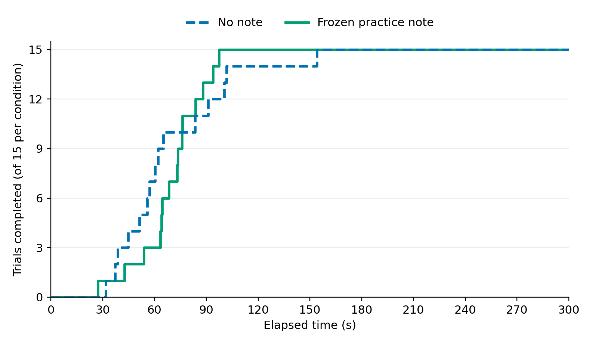

# Can fresh MineCollab teams use a note from practice?

Two GPT-6 Luna agents shared a fresh Minecraft kitchen in each episode. Each agent knew its own dish and its partner’s recipe. Ingredients were split between them. The episode succeeded when both agents held their own dishes at the same time for an observed 250 milliseconds. We measured full completion by 300 seconds and the time to reach it.

All eight practice episodes completed. Their finish times ranged from 13.4 to 203.5 seconds. After each episode, the model updated a reusable note using the practice trace. The eighth update produced a 180-word note. It advised the agents to check inventories, agree who would craft each dish, and confirm ingredient transfers. It included no exact recipes or coordinates. Evaluation used that frozen note without any further updates. [Frozen note](data/luna/practice/frozen_note.md) · [Practice records](data/luna/practice/practice.json)

The held-out comparison used five repetitions on each of three scenarios. Each matched pair used the same task and deadline. Both teams started fresh. The learned condition received the frozen note, and the baseline used the same prompt without it. The published evidence records the fixed seed, assignment order, task profiles, and inventory events. [Protocol and runner](README.md) · [Reproduction guide](REPRODUCE.md)

## Both conditions finished every held-out trial

| Scenario | No note | Frozen note | Mean time difference, note minus no note |
| --- | ---: | ---: | ---: |
| Golden apple and bread with reassigned roles | 5/5 | 5/5 | −5.5 s |
| Cookies and pumpkin pie | 5/5 | 5/5 | +7.3 s |
| Mushroom stew and beetroot soup | 5/5 | 5/5 | +0.3 s |
| **All held-out trials** | **15/15** | **15/15** | **+0.7 s** |

The teams averaged 69.0 seconds without the note and 69.7 seconds with it. Median times were 60.2 and 73.0 seconds, respectively. The note condition finished faster in six matched pairs and slower in nine. The differences ranged from 85.8 seconds faster to 49.3 seconds slower. The exact two-sided sign-flip reference for the mean time difference was *p* = 0.943. [Paired outcomes and times](luna-results.json)

At 60 seconds, seven baseline teams and three note teams had finished. By 100 seconds, 12 baseline teams and all 15 note teams had finished. The curves cross and the average difference was under one second. In these samples, there was no consistent speed advantage. At the five-minute deadline, completion was already at the ceiling in both conditions. This study estimates the effect of one note on three scenarios with GPT-6 Luna. A broader transfer claim would require more independent notes and tasks.

## Run health and audit

All eight practice episodes and all 30 scored evaluation episodes recorded both agents joining, GPT-6 Luna responses, and replayable inventory outcomes. A provider prompt rejection interrupted one baseline attempt after one model response. The same assignment ran successfully on a fresh world with the same settings. The rejected attempt is retained separately. There were zero scoreable timeouts. The batch took 35 minutes and 17 seconds from the first practice start to the last verified finish. [Rejected attempt](data/luna/eval-1/021-baseline-held_out_role_hells_kitchen-4/result.json) · [Study evidence](data/luna)
